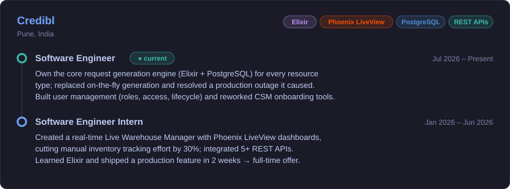
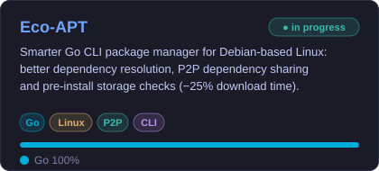
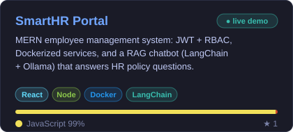
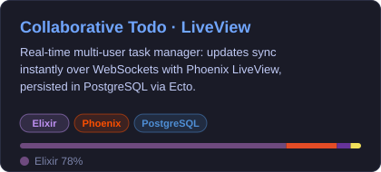
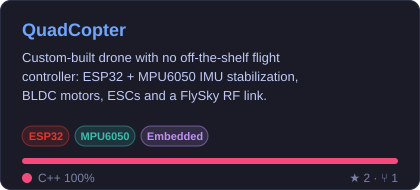
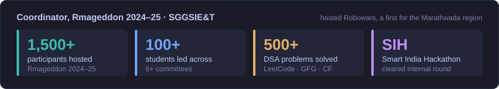
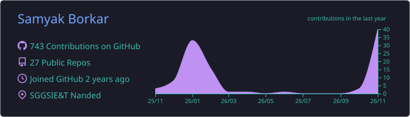
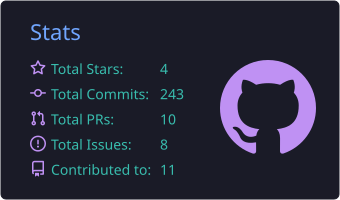
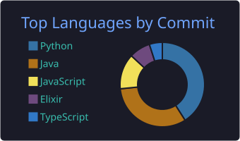

<p align="center">
  
</p>

<p align="center">
  <a href="https://github.com/SamyakBorkar">
    
  </a>
</p>

<p align="center">
  <a href="https://www.linkedin.com/in/samyak-borkar-2a150528a/"></a>
  <a href="mailto:borkarsamyak66@gmail.com"></a>
  <a href="https://portfolio-silk-sigma-66.vercel.app"></a>
  <a href="https://leetcode.com/u/Samyak_Borkar96/"></a>
  <!-- Codolio: replace TODO with your username, then remove these comment markers
  <a href="https://codolio.com/profile/TODO"></a>
  -->
</p>

<p align="center">
  
</p>

---

### 👨‍💻 About me

```go
type Engineer struct {
	Name       string
	Role       string
	Location   string
	Focus      []string
	Interests  []string
	Hobbies    []string
}

var samyak = Engineer{
	Name:       "Samyak Borkar",
	Role:       "Software Engineer @ Credibl",
	Location:   "Pune, India",
	Focus:      []string{"Backend", "Elixir / Phoenix", "Go"},
	Interests:  []string{"AI & RAG apps", "DevOps", "Fintech", "Open source"},
	Hobbies:    []string{"Building drones 🚁", "Running robotics events 🤖"},
}
```

### 💼 Experience

<p align="center">
  
</p>

### 🛠️ Projects

<p align="center">
  <a href="https://github.com/SamyakBorkar/ECO-APT"></a>
  <a href="https://smarthr-zeta.vercel.app"></a>
  <a href="https://github.com/SamyakBorkar/collabarative-todo-liveview-"></a>
  <a href="https://github.com/SamyakBorkar/QuadCopter"></a>
</p>

### 🧰 Tech stack

| Area | Tools |
|:--|:--|
| **Languages** |  |
| **Backend** |   |
| **Frontend** |  |
| **Databases** |  |
| **AI / ML** |    |
| **DevOps & Tools** |  |
| **Hardware** |  |

### 🏆 Achievements & leadership

<p align="center">
  
</p>

### 📊 GitHub stats

<p align="center">
  
</p>

<p align="center">
  
</p>

<p align="center">
  
  
</p>

<p align="center">
  
</p>

<p align="center">
  <picture>
    <source media="(prefers-color-scheme: dark)" srcset="https://raw.githubusercontent.com/SamyakBorkar/SamyakBorkar/output/github-snake-dark.svg" />
    
  </picture>
</p>

<p align="center">
  
</p>
